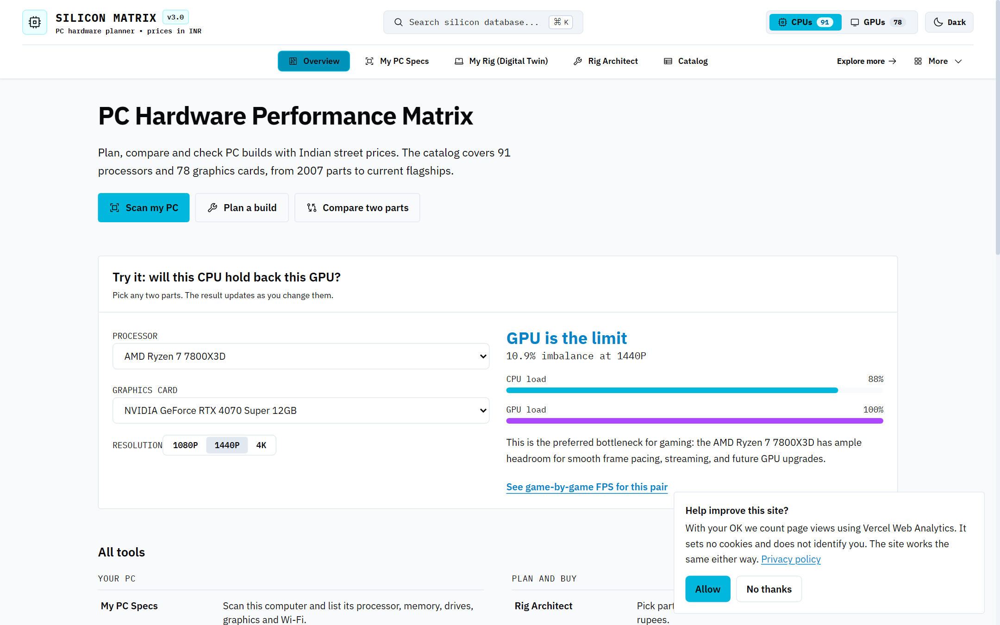
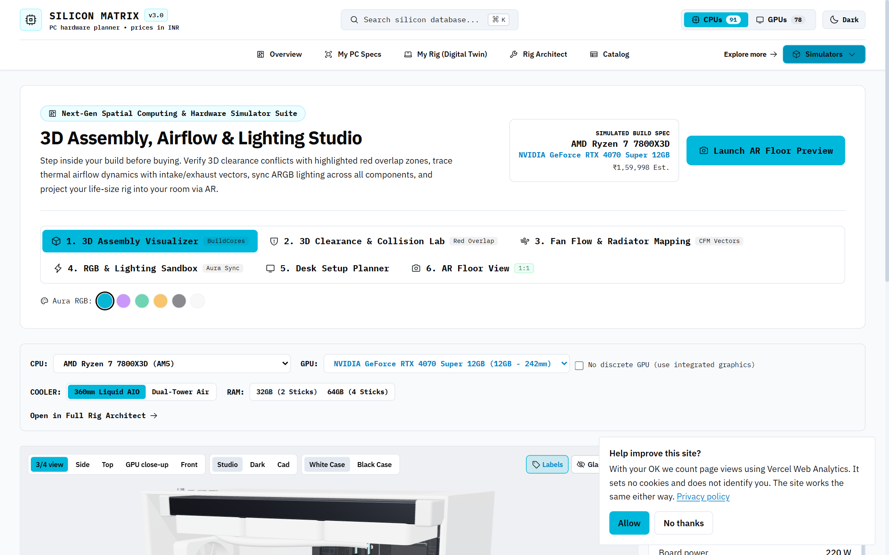
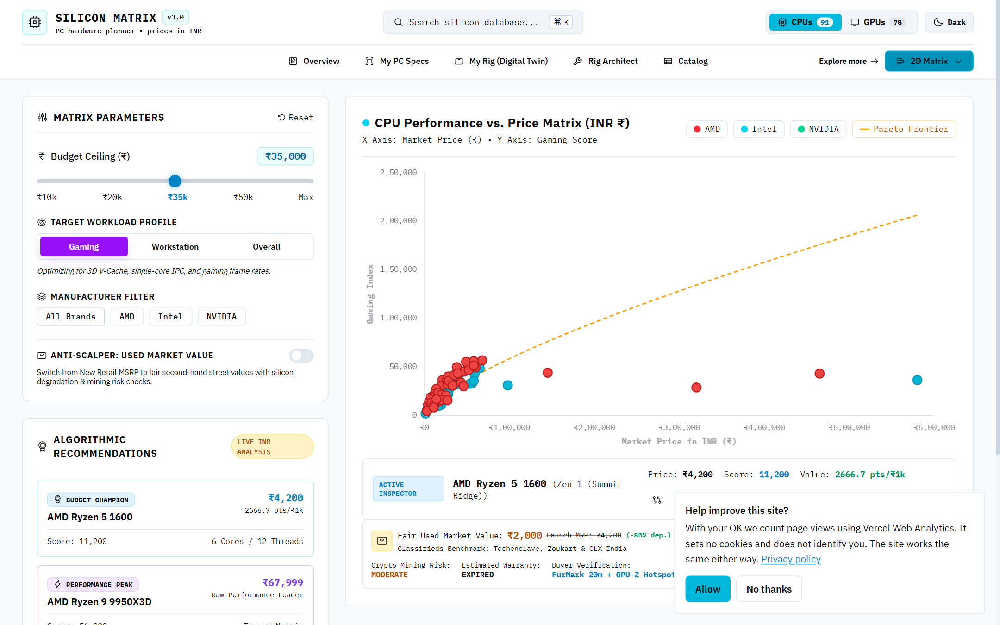
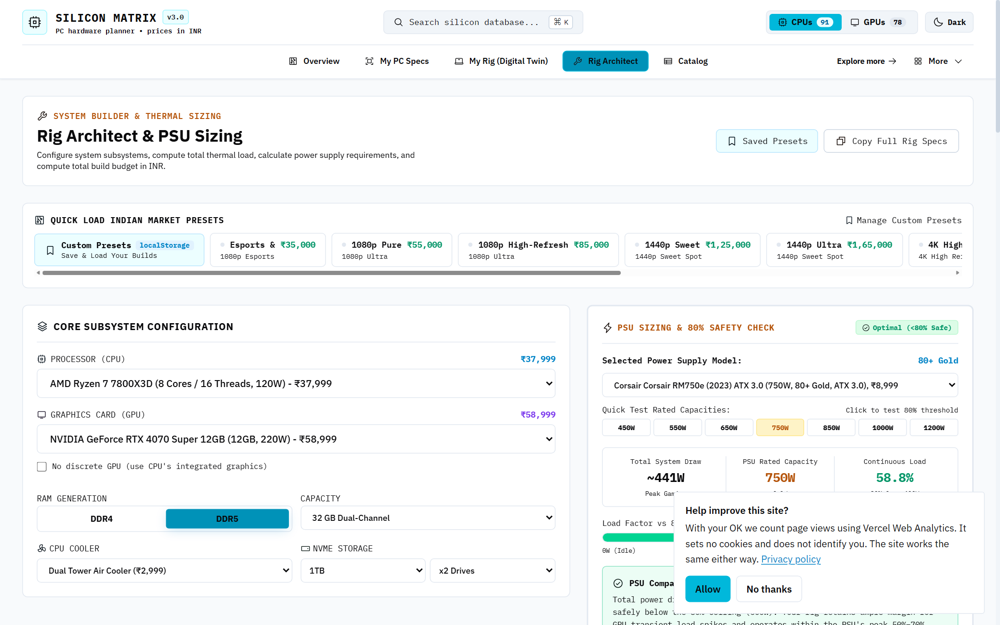
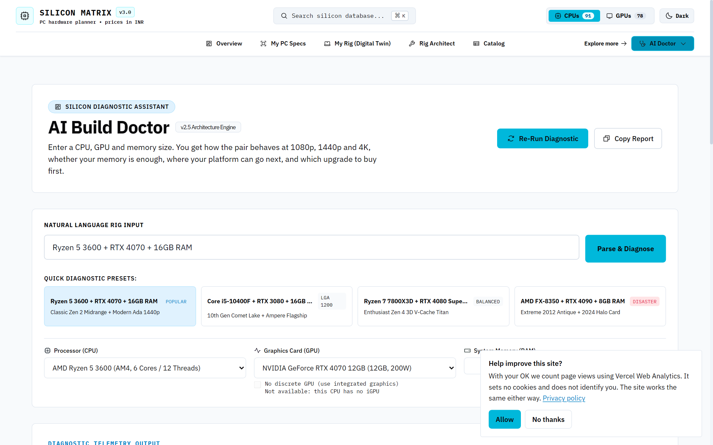
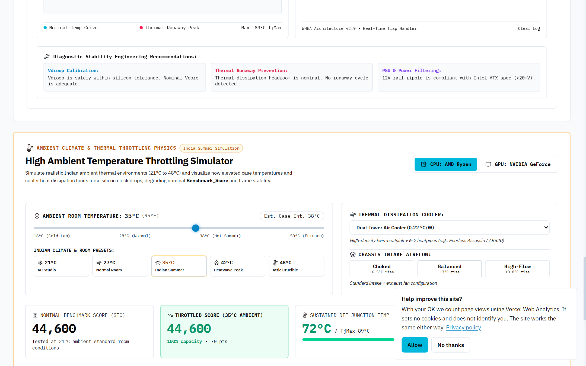
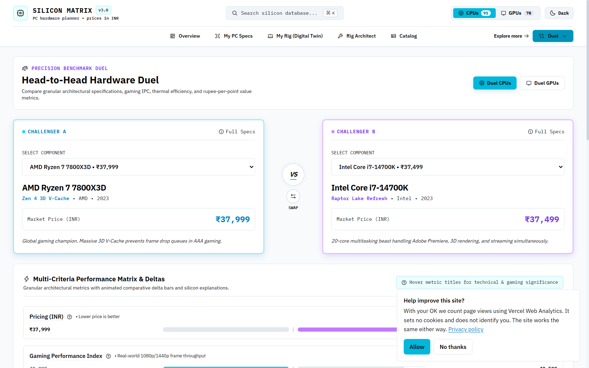
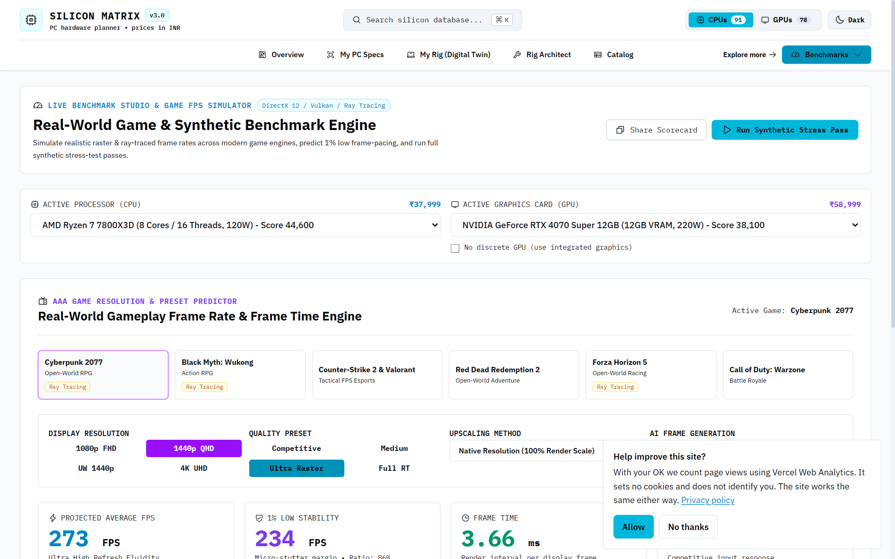
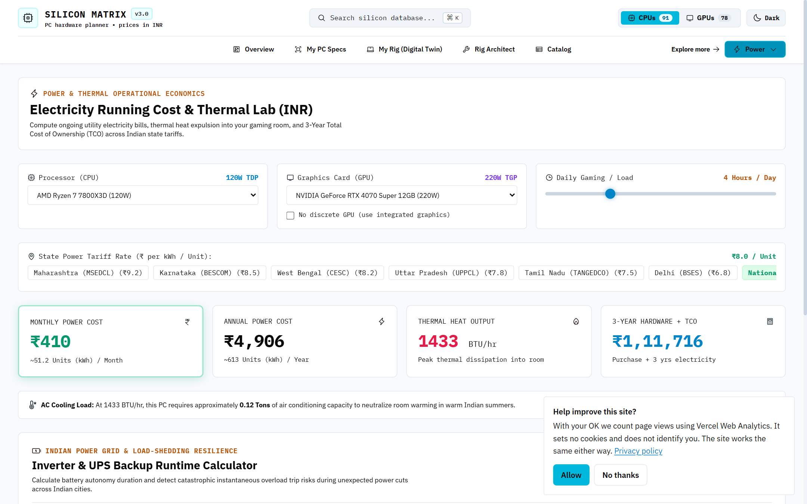
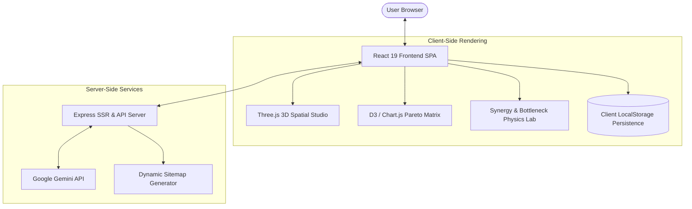

# RigForge (Silicon Matrix)

**Plan a PC build, check it for bottlenecks and power limits, and price it in ₹ INR, all in the browser.**

### [▶ Try it live: rigforge-livid.vercel.app](https://rigforge-livid.vercel.app)

[](https://vercel.com/new/clone?repository-url=https%3A%2F%2Fgithub.com%2Ftheflighttechofficial%2FRigForge&env=GEMINI_API_KEY&envDescription=Optional.%20Without%20it%20the%20AI%20Build%20Doctor%20uses%20its%20built-in%20rules.)
[](LICENSE)




## Quick start

```bash
git clone https://github.com/theflighttechofficial/RigForge.git && cd RigForge
npm install
npm run dev        # open http://localhost:3000
```

Or run it in Docker:

```bash
docker build -t rigforge . && docker run -p 3000:3000 rigforge
```

No API key is needed. Add `GEMINI_API_KEY` to `.env` to turn on AI answers in the Build Doctor; without it, the Build Doctor uses its built-in rules.

## What it does

- **Catalog of 91 CPUs and 78 GPUs** with ₹ street prices and synthetic benchmark scores.
- **Bottleneck check** for a CPU/GPU pair at 1080p, 1440p, 4K and workstation loads.
- **Rig builder** with socket checks, PSU sizing at 80% load and an 18% GST breakdown.
- **Price-to-performance chart** that marks the parts on the Pareto frontier.
- **FPS estimates** by game, resolution, quality preset and DLSS/FSR.
- **Running cost** over 3 years using state electricity tariffs (BESCOM, MSEDCL, BSES and others).
- **3D assembly view** with exploded view, airflow view and part clearance checks.
- **Hardware scan** of your own PC through a small Windows, macOS or Linux agent.

## Screenshots

<table align="center" width="100%">
  <tr>
    <td width="50%" align="center">
      <h3>🧊 3D Spatial Computing Studio</h3>
      <a href="docs/screenshots/3d-studio.png">
        
      </a>
      <p><em>WebGL assembly view with exploded view, airflow view and clearance checks.</em></p>
    </td>
    <td width="50%" align="center">
      <h3>📊 Price-to-Performance Pareto Matrix</h3>
      <a href="docs/screenshots/value-matrix.png">
        
      </a>
      <p><em>2D scatter analysis mapping ₹ INR street pricing against synthetic compute scores with Pareto-frontier curves.</em></p>
    </td>
  </tr>
  <tr>
    <td width="50%" align="center">
      <h3>🛠️ Rig Architect Configurator</h3>
      <a href="docs/screenshots/builder.png">
        
      </a>
      <p><em>Full 8-part build architect with dynamic socket compatibility, 80% PSU load margin sizing & Indian retail pricing with GST.</em></p>
    </td>
    <td width="50%" align="center">
      <h3>🩺 AI Build Doctor</h3>
      <a href="docs/screenshots/build-doctor.png">
        
      </a>
      <p><em>Describe a build in plain English; get bottlenecks and upgrade advice from Gemini or the built-in rules.</em></p>
    </td>
  </tr>
  <tr>
    <td width="50%" align="center">
      <h3>🔬 Synergy & Bottleneck Physics Lab</h3>
      <a href="docs/screenshots/bottleneck.png">
        
      </a>
      <p><em>Resolution-sensitive pipeline queue simulation across 1080p, 1440p, 4K, and Workstation stress tests.</em></p>
    </td>
    <td width="50%" align="center">
      <h3>⚔️ Architectural Head-to-Head Duel</h3>
      <a href="docs/screenshots/compare.png">
        
      </a>
      <p><em>Side-by-side component breakdown with 6-axis workload radar charts, lithography details, and cache topology.</em></p>
    </td>
  </tr>
  <tr>
    <td width="50%" align="center">
      <h3>🎮 Gaming Benchmarks & FPS Engine</h3>
      <a href="docs/screenshots/benchmarks.png">
        
      </a>
      <p><em>Estimated frame rates across AAA titles by resolution, quality presets, DLSS/FSR upscaling & frame generation.</em></p>
    </td>
    <td width="50%" align="center">
      <h3>⚡ TCO & DISCOM Electricity Engine</h3>
      <a href="docs/screenshots/power-cost.png">
        
      </a>
      <p><em>3-year running electricity cost projections mapped against state DISCOM tariffs (BESCOM, MSEDCL, BSES) and UPS sizing.</em></p>
    </td>
  </tr>
</table>

---

## 🏗️ Architectural Overview

The app is a React 19 single-page app built with Vite 6. An Express server serves the built files, generates the sitemap and proxies requests to the Gemini API so the key stays on the server. On Vercel, the same Express app runs as a serverless function (`api/index.ts`).



---

## 🛠️ Feature Details

### 1. 3D Spatial Computing & Interactive Assembly
- **Exploded View Mechanics**: Moves apart the chassis along z-axes to inspect RAM slot alignment, AIO pump clearance, motherboard VRM heatspreaders, and GPU sag bracket mountings.
- **Multi-Mode Visual Shading**: Switch between PBR rendering, CAD Wireframe viewports, and Thermal Heat Map overlays.
- **Clearance & Collision Detection**: Real-time bounding-box check identifying RAM height vs. AIO radiator overhangs, GPU length vs. front intake fans, and PSU depth vs. drive cages.
- **Airflow Particle Dynamics**: Visualizes intake/exhaust static pressure loops (positive, neutral, negative flow) and calculates dust-accumulation potential over time.
- **RGB Lighting Sandbox**: Customizable RGB zones supporting presets (*Cyberpunk Cyan, Matrix Emerald, Tokyo Violet*) with dynamic pulse and breathing animations.
- **AR WebXR Floor Projection**: Projects 1:1 scale tower models into physical space via mobile camera viewports.

### 2. AI Build Doctor
- **Gemini integration**: Sends natural language specs (e.g., *"i5-12400F with RTX 4080 Super for 4K video editing"*) through a secure server-side proxy (`/api/build-doctor`).
- **Rules-based fallback**: If no API key is set, or the API call fails, the Build Doctor answers from local rules instead.
- **Diagnostic Insights**: Delivers socket upgrade paths, VRM power phase adequacy ratings, memory bottleneck warnings, and targeted component swap recommendations.

### 3. Price-to-Performance Pareto Matrix
- **Dynamic Frontier Calculation**: Plots 91 CPUs and 78 GPUs against price point and synthetic compute scores, automatically highlighting non-dominated Pareto optimal parts.
- **Multi-Decade Dataset**: Spans 2007 through 2025, enabling historical value trajectory analysis across legacy and modern architectures.
- **Filters & Direct Routing**: Filter by vendor (NVIDIA, AMD, Intel), release era, TDP envelope, or socket type with single-click routing into the Comparison Duel.

### 4. Synergy, Bottleneck & Physics Lab
- **Resolution-Sensitive Queue Simulation**: Models frame-time rendering breakdown across 1080p, 1440p, 4K, and Ultrawide displays.
- **Adverse Mismatch Alerts**: Detects severe PCIe bus bottlenecks (e.g., PCIe 3.0 x4 limitations on budget GPUs) and core/thread starvation.
- **Stability & LLC Stress Test**: Simulates Load-Line Calibration (LLC) vdroop, 12V transient power spikes, and thermal runaway scenarios under 100% synthetic load runs.
- **Indian Ambient Summer Modeling**: Evaluates thermal throttling under ambient room temperatures up to 45°C for Stock, Air Tower, and 240/360mm AIO coolers.

### 5. Rig Architect & Indian Builder Suite
- **Full 8-Component Configurator**: Interactive selection of CPU, GPU, Motherboard, RAM, Storage, PSU, Cabinet, and Cooling.
- **Automated Validation Engine**: Real-time checking of Socket Compatibility, VRM Thermal Requirements, Total System TDP, and Form-Factor Alignment (ATX, Micro-ATX, Mini-ITX).
- **Indian Retail Localization**: Integrated pricing in ₹ INR including automated 18% GST tax breakdown, vendor availability links, and budget presets from ₹50,000 to ₹2,50,000+.

### 6. Deep Hardware Labs & Subsystem Simulations
- **Silicon Anatomy & Die Inspector**: Detailed floorplans of AMD Zen 4/5 CCDs, Intel Raptor/Arrow Lake compute tiles, and NVIDIA Ada/Blackwell SM layouts.
- **RAM Configuration Lab**: Dual vs. Quad-channel bandwidth, XMP/EXPO timing profiles, sub-timing latency calculations, and infinity fabric ratio impacts.
- **Storage I/O Performance Lab**: Benchmarks sequential and random 4K IOPS across SATA, NVMe Gen3/Gen4/Gen5 SSDs, and legacy mechanical drives.
- **TCO & DISCOM Electricity Engine**: Calculates 3-year ownership expenses using regional tariff tiers (MSEDCL, BESCOM, BSES, TANGEDCO, UPPCL, WBSEDCL) with usage pattern customization.
- **Upgrade ROI Engine**: Quantifies ₹ cost per additional FPS gained and calculates estimated secondary market resale depreciation over 12–36 months.

---

## 💻 Tech Stack & Architecture

| Layer | Technologies & Dependencies | Purpose |
| :--- | :--- | :--- |
| **Core Framework** | [React 19.0](https://react.dev/), [TypeScript 5.8](https://www.typescriptlang.org/) | UI and type checking |
| **Build System** | [Vite 6.2](https://vitejs.dev/), [tsx](https://github.com/privatenumber/tsx), [Esbuild](https://esbuild.github.io/) | Dev server with HMR & production bundling |
| **3D Rendering** | [Three.js v0.186](https://threejs.org/) | WebGL graphics, scene graphs, lighting, & 3D object rendering |
| **Styling & UI** | [Tailwind CSS v4.1](https://tailwindcss.com/), `@tailwindcss/vite` | Utility-first styling |
| **Animations** | [Motion v12.23](https://motion.dev/) | Layout, modal and tab transitions |
| **Data Viz** | [Chart.js v4.5](https://chartjs.org/), [D3.js v7.9](https://d3js.org/) | Pareto scatter charts, radar plots, & timeline graphics |
| **Backend & AI** | [Express v4.21](https://expressjs.com/), `@google/genai` SDK 2.4 | Server API routes, Gemini AI proxy, and sitemap generation |
| **Utilities** | [jsPDF v4.2](https://github.com/parallax/jsPDF), [canvas-confetti](https://www.npmjs.com/package/canvas-confetti) | PDF export and confetti effects |

---

## 📁 Project Directory Structure

```
RigForge/
├── api/                     # Vercel & serverless API endpoints
├── data/                    # Hardcoded hardware specification datasets
├── docs/                    # Documentation & visual showcases
│   └── screenshots/         # Hi-res captures of platform workspaces
├── public/                  # Static assets, icons, manifest files
├── scripts/                 # Post-build routines & dynamic sitemap generators
│   ├── generate-sitemap.ts  # Dynamic XML sitemap builder
│   ├── postbuild.ts         # Post-bundle copy routines
│   └── take-screenshots.mjs # Automated headless viewport capture suite
├── src/                     # React application source code
│   ├── components/          # Feature UI modules
│   │   ├── spatial/         # Three.js 3D viewport scenes & shaders
│   │   ├── AIBuildDoctor.tsx
│   │   ├── HardwareCatalog.tsx
│   │   ├── HeadToHead.tsx
│   │   ├── PerformanceMatrix.tsx
│   │   ├── RigArchitect.tsx
│   │   ├── RunningCostLab.tsx
│   │   ├── Spatial3DStudio.tsx
│   │   └── SynergyLab.tsx
│   ├── data/                # Client hardware catalog index files
│   ├── utils/               # Calculation engines, physics models, cache helpers
│   ├── App.tsx              # Root application router & layout state
│   ├── main.tsx             # React DOM root entry point
│   ├── routes.ts            # Dynamic routing definitions & meta mappings
│   └── types.ts             # TypeScript definitions for hardware models
├── app.ts                   # Express application setup
├── server.ts                # Main Node server entry point
├── package.json             # Build scripts and dependency configuration
├── tsconfig.json            # TypeScript compiler configuration
└── vite.config.ts           # Vite bundler & plugin configuration
```

---

## 🏃 Getting Started

### Prerequisites

Ensure your environment meets the following requirements before installation:
- **Node.js**: `v18.0.0` or higher (v20+ recommended)
- **npm**: `v9.0.0` or higher (or `bun` / `pnpm`)

### Installation

Clone the repository and install dependencies:

```bash
# Clone the repository
git clone https://github.com/theflighttechofficial/RigForge.git

# Navigate to project directory
cd RigForge

# Install project dependencies
npm install
```

### Development Workflow

Start the development server with hot module replacement (HMR):

```bash
npm run dev
```
> The application will run at **`http://localhost:3000`** (or the port specified in environment configuration).

### Production Build & Bundle

To compile client assets and build the Node server bundle:

```bash
# Generate sitemap, compile React frontend, and bundle Express server
npm run build

# Start production server
npm start
```

Other available scripts:
- `npm run lint` — Runs TypeScript compiler diagnostics (`tsc --noEmit`).
- `npm run sitemap` — Regenerates the dynamic XML sitemap.
- `npm run clean` — Cleans build output directories (`dist/`).
- `node scripts/take-screenshots.mjs` — Automated capture of high-resolution platform screenshots to `docs/screenshots/`.

---

## 🔐 Environment Configuration

Create a `.env` file in the project root directory using `.env.example` as a template:

```env
# Optional: Google Gemini API Key for AI Build Doctor natural-language diagnostics
GEMINI_API_KEY=your_gemini_api_key_here

# Optional: Base canonical URL for server-side meta tags and sitemap routing
APP_URL=http://localhost:3000

# Optional: Upstash Redis connection parameters (if caching server responses)
UPSTASH_REDIS_REST_URL=
UPSTASH_REDIS_REST_TOKEN=
```

> **Note**: If `GEMINI_API_KEY` is omitted, the **AI Build Doctor** automatically falls back to its internal deterministic rules engine without throwing errors or breaking UI flows.

---

## ⚡ Performance & Security

- **Lazy-Loaded Modules**: All major lab views and spatial 3D components are code-split using `React.lazy()` and `Suspense`, so the first page load stays small.
- **Client-First Privacy**: Benchmarks, saved builds, and custom settings persist locally via browser `localStorage`. No user build data is collected or transmitted to external tracking servers.
- **Server API Defense**: The Gemini AI integration is proxied via the Express backend to prevent exposing API credentials on the client side.

---

## 🤝 Contributing

Contributions are welcome. To contribute:

1. **Fork** the repository.
2. Create a feature branch: `git checkout -b feature/my-change`.
3. Commit your changes: `git commit -m 'Describe your change'`.
4. Push to the branch: `git push origin feature/my-change`.
5. Open a **Pull Request**.

Please ensure your code passes `npm run lint` before submitting PRs.

---

## 📄 License & Trademarks

This project is licensed under the MIT License. See [LICENSE](LICENSE). Release notes are in [CHANGELOG.md](CHANGELOG.md).

*Disclaimer: All product names, logos, brands, and trademarks (such as Intel, AMD, NVIDIA, Ryzen, GeForce, Radeon) are property of their respective owners. Their usage in this project is for educational, identification, and hardware performance comparison purposes only.*
